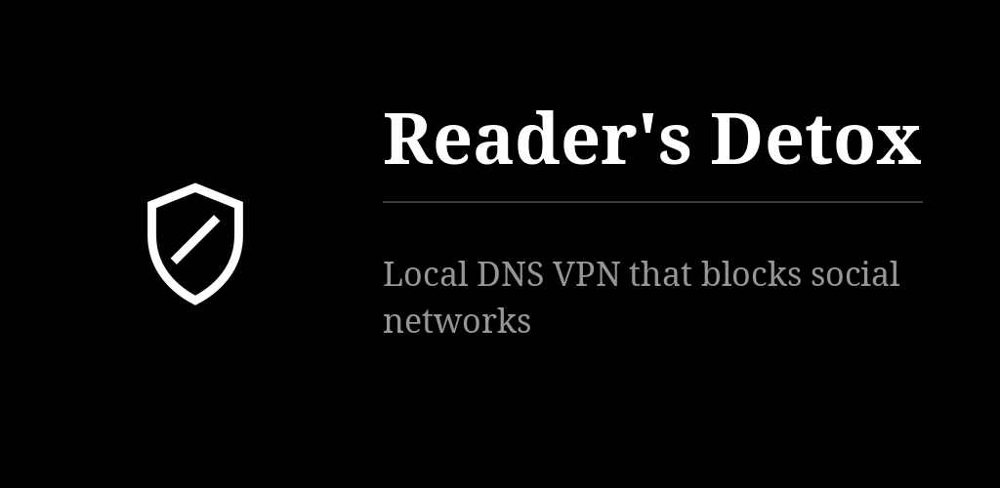
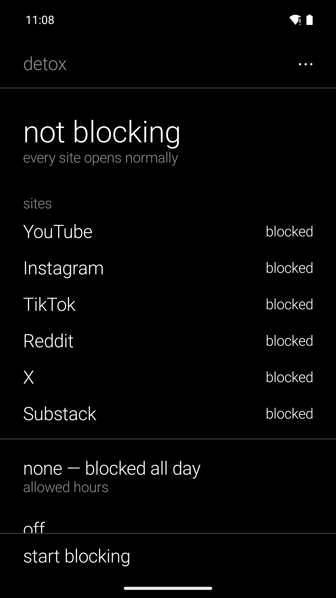

# Reader's Detox (formerly Social Detox)

Blocks social networks on the phone with a local DNS VPN. The filtering happens on the device,
with no account. Only the names of the sites you look up pass through the app, never the traffic
itself. They go to your network's own name servers as usual; if those do not answer, the app asks
[Quad9](https://quad9.net), a Swiss non-profit name service, so that the phone keeps working.
The hours and the daily budget you set stay locked while blocking is on.
Works on IPv6-only carriers. A fork of [SocialBlocker](https://github.com/funkypitt/SocialBlocker)
without the password: a detox you impose on yourself, not a parental control — for a child's
device, use the original.

## Key points

* Choose the sites — YouTube, Instagram, TikTok, Reddit, X, Substack — then "start blocking".
  Android asks once for the VPN consent.
* Allowed hours: a list of ranges during which the sites open; none means blocked all day. A
  range ending earlier than it starts runs past midnight.
* Daily budget: a number of minutes a day in the apps of the chosen sites (YouTube, Instagram,
  TikTok, Reddit, X, Substack and their usual clients). The sites stay open until the minutes
  are spent, then they are blocked until midnight. Counted in the apps, not in a browser, with
  the phone's usage access. With hours too, both apply.
* While blocking, the sites, the hours, the budget and the maths switch are locked (only Substack stays
  free). To change them, stop first.
* Optional gate: five maths problems, each harder than the last, before blocking stops.
* Widget: the state in words, and a switch. Turning it off takes the app's path, maths included.
* Restarts after a reboot and an app update. For the strongest hold, make it the always-on VPN
  and allow it to run in the background; the app points to both settings.
* Limits: it takes the phone's single VPN slot, and you can lift it whenever you want. Turning
  the VPN off in the system settings counts as stopping.
* Black and white, text only, six languages. Installs beside the original SocialBlocker
  (different application id).

## Family build (a child's phone)

A second build, `famille`, exists for a child's phone, delivered as an APK outside F-Droid
(same application id and key: it installs over the public one). It adds:

* **A parent PIN**, four to eight digits, set in *sections with a quota*. Once set, the whole
  app opens on it: stopping, the sites, the hours, the budget and the sections. The widget's
  switch opens the app on the PIN instead of stopping.
* **Section quotas**: minutes a day on one *part* of an app while the rest stays open —
  WhatsApp's *Updates* tab and channels (chats and calls stay free), CapCut's *Templates* tab and
  its *For you* feed (the editor stays free). One figure for the week, one for the weekend;
  0 closes the section all day. The time runs only while that part is on the screen and the
  screen is on; the count starts again at midnight. Spent, the section is left (a tap on the
  *Chats* or editor tab, else Back) with a short message; a warning five minutes before is
  optional. Kept by an accessibility service limited to those two apps.
* **Rules in a file**, not in the code: which screens count as a section is read from
  [docs/RULES.md](docs/RULES.md)'s JSON, bundled and replaceable from the app, with a discovery
  mode for the parent to capture the structure of the screens when WhatsApp or CapCut change.
* **Privacy**: the service compares view ids and labels in memory for the length of one look,
  keeps nothing of the screens and never reads a message; outside discovery mode no text from
  a screen is written anywhere.
* **Family Link**: the child can switch an accessibility service off or uninstall the app
  unless the device manager locks both; the app notifies the parent when its service is off.

Device checks: [docs/TEST-CHECKLIST.md](docs/TEST-CHECKLIST.md). The public build carries
neither the PIN nor the service.

More detail: [docs/NOTES.md](docs/NOTES.md).

## Install


[](https://gallaz.ch/eink/#socialblocker-detox)

- **F-Droid** (recommended, updates arrive by themselves): add the repository from [gallaz.ch/eink](https://gallaz.ch/eink/#fdroid), or the address `https://funkypitt.github.io/fdroid-repo/repo` in F-Droid.
- **Obtainium**: tap the badge on the phone, or add `https://github.com/funkypitt/SocialBlocker-Detox` in Obtainium.
- **APK**: attached to the [latest release](../../releases/latest). No automatic updates.

All three deliver the same file, with the same signature.

## Build

```
./gradlew assemblePubliqueDebug     # the public app
./gradlew assembleFamilleRelease    # the family build (PIN + section quotas), signed with gallaz-sign
./gradlew testFamilleDebugUnitTest  # unit tests
```

minSdk 24, targetSdk 34. The UI is Kotlin + Jetpack Compose; the VPN service is the original Java.

## Crédits / Credits

Basé sur / Based on [SocialBlocker](https://github.com/funkypitt/SocialBlocker) by Pierre Gallaz, GPL-3.0-only.

© 2026 Pierre Gallaz. Développé avec [Claude Code](https://claude.com/claude-code) (Anthropic).
Licence GPL-3.0-only, voir `LICENSE`.

© 2026 Pierre Gallaz. Developed with [Claude Code](https://claude.com/claude-code) (Anthropic).
GPL-3.0-only licence, see `LICENSE`.

## Captures d'écran


